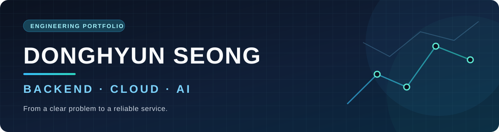

  

  <h2>안녕하세요, 성동현입니다.</h2>
  
<strong>문제를 데이터 흐름과 서비스 구조로 풀어내는 백엔드·클라우드 개발자</strong>

  
Java·Spring Boot를 중심으로 API를 만들고 AWS에 배포합니다. 
  AI 기능을 서비스에 연결할 때는 입력 계약, 검증, 장애 상황까지 함께 살핍니다.

  <a href="#toolbox">기술</a> ·
  <a href="#featured-project">대표 프로젝트</a> ·
  <a href="#more-work">다른 작업</a>

---

## Toolbox

**Backend & data**

**Frontend & AI**

**Cloud & delivery**

## Featured project

### 🍽️ [Mealfit — 대학 급식 수요 예측 서비스](https://github.com/dhs82/Mealfit)

메뉴와 학기별 학생 수를 관리하고, 예측 모델이 계산한 식사 비율을 예상 식수 인원으로 연결하는 웹 애플리케이션입니다.

| 문제에서 구현까지 | 제가 맡은 일 |
| --- | --- |
| 식단·인원 데이터를 함께 관리 | React 화면과 AppSync·DynamoDB 데이터 흐름 통합 |
| 예측을 웹 서비스에서 사용 | Python 추론 코드를 Lambda 서비스로 분리하고 API 연결 |
| 변경을 검증 가능한 형태로 유지 | 기능 단위 프론트 구조, 모델 체크섬, 테스트·GitHub Actions 정리 |

  
   
  Mealfit 로컬 데모 화면 · 이미지 클릭 시 프로젝트 README로 이동

  <a href="https://github.com/dhs82/Mealfit#features"><strong>기능 보기 →</strong></a>
  &nbsp;&nbsp;
  <a href="https://github.com/dhs82/Mealfit#screenshots"><strong>화면 보기 →</strong></a>
  &nbsp;&nbsp;
  <a href="https://github.com/dhs82/Mealfit#architecture"><strong>구조 보기 →</strong></a>

## More work

아래 작업은 현재 코드 저장소가 비공개인 프로젝트의 **소개 요약**입니다.

| 프로젝트 | 문제와 접근 | 제 역할 |
| --- | --- | --- |
| **MARU** · 접근성 중심 주거 플랫폼 | 생활 조건을 반영한 매물 비교와 DB 근거 기반 상권 설명 | 인증·추천·지도·이미지 저장, SQL RAG, AWS 배포 |
| **Petjari** · 반려동물 주거 플랫폼 | 허용 정책의 충돌과 미확인 정보를 구분하는 도메인 전환 | 펫 도메인 계약 정의·검수, 코드·문서 전환, AI 협업 결과 검증 |

---

좋은 결과는 기능 설명뿐 아니라 근거, 검증 범위, 남은 과제를 함께 기록할 때 나온다고 생각합니다.

